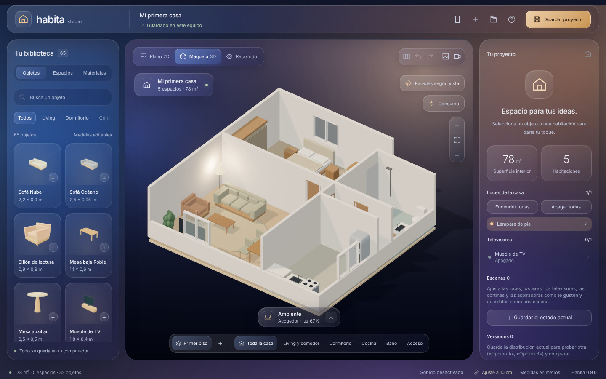
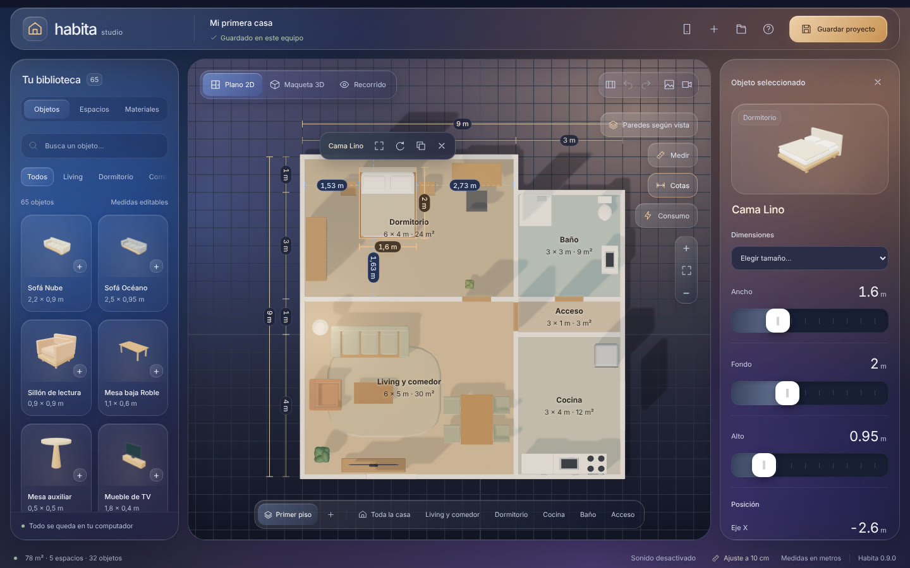
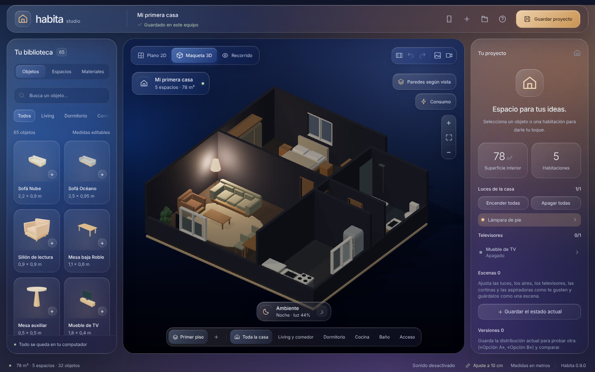
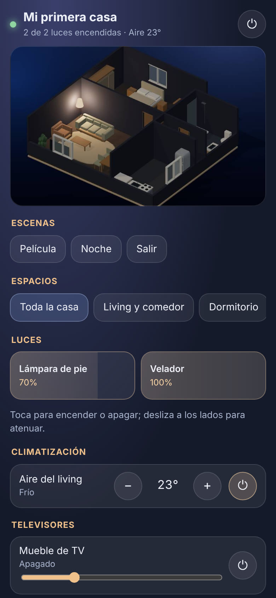

# Habita Studio

Editor de casas para Windows: dibujas el plano, amueblas en una maqueta 3D y, si quieres,
controlas las luces, aires, televisores, cortinas y aspiradora reales desde esa misma maqueta.
Funciona en tu computador, sin cuentas ni servicios en la nube.



## Instalar en Windows

No necesitas saber de computación ni crear una cuenta. Son tres pasos:

1. **Descarga el instalador.** Entra a la página de
   [descargas (Releases)](https://github.com/b3nj43lpr0/Habita/releases/latest) y, en la
   sección **Assets**, haz clic en el archivo que empieza con **Habita-Studio-Setup** y termina
   en `.exe` (por ejemplo `Habita-Studio-Setup-0.9.0.exe`). Se guardará en tu carpeta
   **Descargas**.
2. **Ábrelo con doble clic.** Lo encuentras en **Descargas** o en el aviso de descarga del
   navegador. No hay que elegir opciones ni pedir permisos de administrador.
3. **Listo.** Habita Studio se abre solo y queda un acceso directo en el **escritorio** y en el
   **menú Inicio** para las próximas veces.

### Si aparece «Windows protegió su PC»

La primera vez, Windows puede mostrar una ventana azul que dice **«Windows protegió su PC»**.
Aparece porque el programa es nuevo y no tiene una firma comercial, no porque se haya encontrado
un problema. Para seguir:

1. Haz clic en el texto **Más información**, debajo del mensaje.
2. Aparecerá el botón **Ejecutar de todas formas**: haz clic en él.

Windows no vuelve a preguntar después de la instalación.

Si el navegador avisa que el archivo «no se descarga habitualmente», elige **Conservar** (en
Edge está en el menú `…` junto a la descarga). Descarga siempre desde el enlace de arriba para
tener la versión original.

### Otros avisos que puedes ver

- **Firewall de Windows**: si activas el *control desde el celular*, Windows puede preguntar si
  Habita puede usar la red. Marca **Redes privadas** y pulsa **Permitir**.

### Actualizar o desinstalar

- **Actualizar**: descarga el instalador nuevo desde la misma página y ábrelo con doble clic;
  reemplaza la versión anterior. Tus proyectos `.habita` y el autoguardado se mantienen.
- **Desinstalar**: en Windows abre **Configuración → Aplicaciones**, busca *Habita Studio* y
  elige **Desinstalar**.

### ¿Sin instalar?

En la misma página está **Habita-Studio-…exe** (sin «Setup»): es la versión *portable*. Se
abre directo con doble clic, sin instalar nada, y sirve para llevarla en un pendrive. El aviso
de «Windows protegió su PC» se pasa igual que arriba. Para quitarla basta con borrar el archivo.

## Qué puedes hacer

**Diseñar**
- Empezar desde una plantilla (casa de ejemplo, departamento, estudio, una habitación o plano
  vacío) o dibujar tus espacios. Varios pisos con escalera.
- Elegir entre 65 objetos (muebles, equipos, puertas y ventanas) con medidas editables,
  materiales y colores.
- Medir: cotas automáticas en el plano 2D, distancia libre de cada mueble a los muros y una
  huincha entre dos puntos.
- Anotar el plano con notas de colores, armar la lista de compras con precios y guardar
  versiones de la distribución para compararlas.
- Importar el plano de tu casa como imagen y calibrarlo con una medida conocida.

**Ver**
- Plano 2D, maqueta 3D y recorrido en primera persona a escala real.
- Ambientes de día, acogedor, cine y noche; paredes que se bajan según desde dónde miras.
- Exportar una imagen o un video del recorrido.

**Controlar la casa real**
- Vincular cada objeto de la maqueta con su equipo de **Home Assistant** o con luces
  **Philips Hue**; la maqueta muestra el estado real.
- Escenas, automatizaciones, sensores de temperatura y de puertas, y mapa de consumo.
- Panel rápido en la bandeja de Windows y **control desde el celular** con un código QR.
- Asistentes de IA por MCP (por ejemplo Claude Desktop o Claude Code), solo en este equipo y
  con permisos que eliges.

| Plano con cotas | Noche | Celular |
| --- | --- | --- |
|  |  |  |

## Ejecutar desde el código

Para desarrollo, con Node.js instalado:

```powershell
npm install
npm run desktop   # la app de escritorio
npm run dev       # solo la interfaz, en el navegador (sin equipos reales)
```

## Uso rápido

- **Objetos**: haz clic en un mueble para agregarlo; arrástralo para moverlo. Las medidas se
  editan en el panel derecho y se aplican al confirmar cada campo.
- **Espacios**: dibuja una habitación marcando dos esquinas, agrega pisos o notas.
- **Plano 2D / Maqueta 3D / Recorrido**: cambia de vista arriba de la maqueta. En el
  recorrido se camina con WASD y se mira con el mouse.
- Los proyectos se guardan como archivos `.habita`; además hay autoguardado en este equipo.

| Atajo | Acción |
| --- | --- |
| Ctrl + Z / Ctrl + Y | Deshacer / rehacer |
| Flechas (Shift: 50 cm) | Mover el objeto elegido |
| R | Girar 90° |
| Ctrl + D · Ctrl + C / V | Duplicar · copiar y pegar |
| Shift + clic · Ctrl + A | Elegir varios · todo el piso |
| M · N | Medir · nota en el plano |
| Supr · Esc | Eliminar · cancelar o cerrar la selección |

## Conectar la casa real

1. **Home Assistant**: en tu perfil de Home Assistant crea un *token de acceso de larga
   duración*. En Habita pulsa el **enchufe** de la barra superior, usa **Buscar en la red** o
   escribe la dirección (por ejemplo `http://homeassistant.local:8123`), pega el token y conecta.
2. **Vincular**: elige un objeto y su equipo real, o usa **Vincular por habitación** para
   vincular toda la casa de una vez. **Diagnóstico** revisa que todo responda.
3. **Philips Hue sin Home Assistant**: en el mismo diálogo busca el puente, pulsa su botón
   redondo y luego **Vincular**.
4. **Celular**: activa *Control desde el celular* (diálogo de conexión o ícono de la bandeja),
   escanea el QR con la cámara y guarda la página en la pantalla de inicio. Funciona en el
   mismo Wi-Fi; Windows puede pedir permiso para redes privadas.
5. **Asistentes de IA**: en el ícono de la bandeja, *Permitir acceso para IA en este equipo* y
   *Copiar configuración MCP*. Editar el plano requiere además *Permitir que la IA edite el
   plano*; el acceso puede apagarse solo después de un tiempo.

Seguridad y privacidad:
- El token de Home Assistant y la clave del puente Hue se guardan cifrados con tu cuenta de
  Windows y nunca llegan a la interfaz ni a los archivos `.habita`.
- Las vinculaciones con equipos reales se guardan aparte del proyecto.
- El acceso de IA escucha solo en `127.0.0.1` con un token que cambia en cada inicio. El
  control desde el celular solo atiende direcciones de la red local y exige la clave del QR,
  que puedes renovar para desvincular celulares.
- Habita no envía datos a servicios propios ni tiene telemetría.

## Desarrollo

```
src/
  main.js        arranque de la interfaz: une el modelo, la maqueta y los paneles
  model/         el proyecto: casa, catálogo, pisos, plano de referencia, escenas,
                 automatizaciones, plantillas, notas, compras y versiones
  devices/       equipos (luces, aires, TV, cortinas, aspiradora), IA y diagnóstico
  scene3d/       maqueta Three.js: escena, muebles, materiales, aire animado y recorrido
  ui/            paneles, diálogos y controles de la interfaz
  styles/        hojas de estilo
desktop/         proceso principal de Electron: Home Assistant, Hue, bandeja, IA (MCP),
                 control desde el celular (remote/) y búsqueda en la red (mDNS)
tools/lab/       Home Assistant y puente Hue simulados para probar sin equipos
tests/           pruebas unitarias (*.test.js) y de la app de escritorio (*.cjs)
docs/            hoja de ruta y capturas
```

| Comando | Para qué |
| --- | --- |
| `npm test` | Pruebas unitarias (modelo, equipos, Home Assistant, Hue, MCP, celular…). |
| `npm run build` | Compila la interfaz en `dist/`. |
| `npm run test:e2e` | Abre la app real contra el laboratorio y recorre los flujos de la casa conectada. |
| `npm run lab` | Home Assistant simulado en `http://127.0.0.1:8123` y puente Hue en `127.0.0.1:8180` (escribe «b» para pulsar su botón). |
| `npm run pack:win` | Instalador y ejecutable portable de Windows en `release/` (`Abrir Habita.cmd` abre el más reciente). |

En Linux sin GPU ni llavero, las pruebas de Electron funcionan con
`xvfb-run electron --use-angle=swiftshader --enable-unsafe-swiftshader --password-store=basic`.

Cada pull request se prueba y se empaqueta en Windows con GitHub Actions
(`.github/workflows/windows.yml`). Para publicar una versión, sube `"version"` en `package.json`
y crea la etiqueta, por ejemplo `v0.9.1`: Actions genera el Release con los dos ejecutables.

El ejecutable se empaqueta con los fuses de Electron endurecidos: sin `ELECTRON_RUN_AS_NODE`,
sin `NODE_OPTIONS` ni `--inspect`, cookies cifradas y solo `app.asar` con integridad validada.

## Más información

- [CHANGELOG.md](CHANGELOG.md): lo nuevo en cada versión.
- [docs/ROADMAP.md](docs/ROADMAP.md): referencias investigadas y lo que viene.

Ideas de [house-control](https://github.com/0xProbabillity/house-control) (MIT) con
implementación propia. Usa [Three.js](https://threejs.org) y
[qrcode](https://github.com/soldair/node-qrcode) (MIT).
